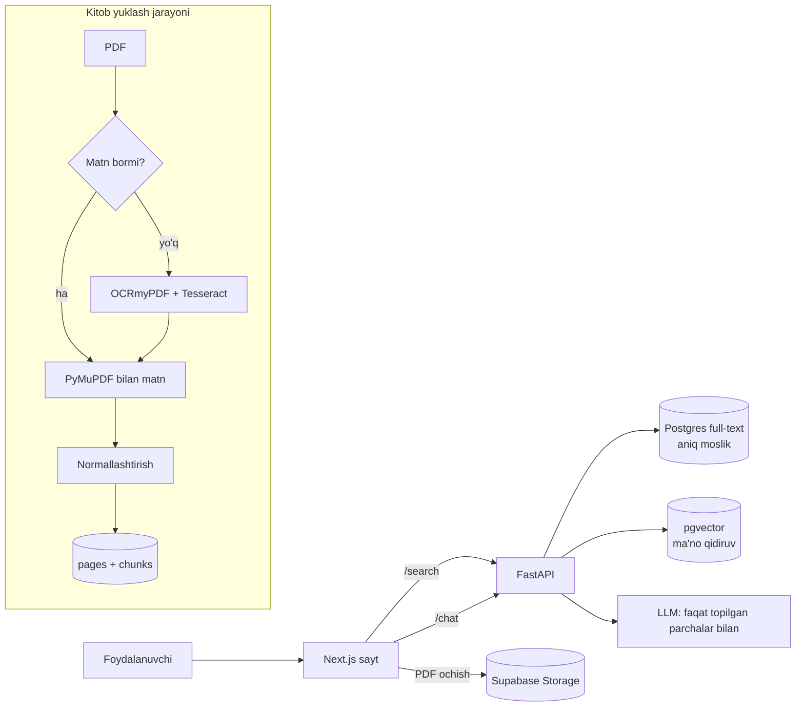

# Detector — Texnik reja (v1)

> Maqsad: foydalanuvchi so‘z yoki ibora yozadi, tizim faqat yuklangan kitoblardan qidiradi va **qaysi kitob, qaysi sahifa, qaysi parchada** borligini aniq ko‘rsatadi.

---

## 1. Asosiy qarorlar

| Masala | Qaror | Sabab |
|---|---|---|
| AI "o‘qitish" | Model **train qilinmaydi** | Train qilingan model to‘qib yuborishi mumkin, 100% aniqlikka zid |
| Qidiruvning asosi | **Exact match** (to‘liq matnli qidiruv) | Natija faqat kitobdagi haqiqiy matndan olinadi |
| AI roli | Yordamchi: o‘xshash ma’no qidiruvi + chatbot | Natijalar "taxminiy" deb alohida belgilanadi |
| Kitoblar | 19 ta, keyin admin orqali qo‘shish mumkin | Hozirgi `KITOBLAR` papkasi |
| Skaner kitoblar | Avval matnli versiya izlanadi, topilmasa OCR | Har sahifada manba belgilanadi: `text` yoki `ocr` |
| Chatbot | Bor, faqat kitob matniga tayanadi (RAG) | Har javob kitob + sahifa havolasi bilan |

---

## 2. Texnologiyalar

### Frontend
- **Next.js 15** (App Router) + **TypeScript**
- **MUI** — tayyor komponentlar (Card, Drawer, TextField)
- **Tailwind CSS** — tezkor stil va glassmorphism
- **Framer Motion** — barcha animatsiyalar (`layoutId`, `spring`, `AnimatePresence`)
- **react-pdf** (PDF.js) — kitob sahifasini ko‘rsatish va so‘zni belgilash
- **TanStack Query** — API so‘rovlari va keshlash

### Backend
- **Python 3.12 + FastAPI**
- **PyMuPDF (fitz)** — PDFdan sahifama-sahifa matn va so‘z koordinatalarini olish
- **OCRmyPDF + Tesseract** (`uzb` + `uzb_cyrl` tillari) — skaner kitoblar uchun
- **LlamaIndex** — chatbot uchun RAG (kitobdan topib, keyin javob berish)
- **Embedding modeli:** `intfloat/multilingual-e5-large` (o‘zbek tilini ham tushunadi)
- **LLM (chatbot):** OpenAI yoki boshqa API, faqat berilgan parchalar asosida javob berishga majburlanadi

### Ma’lumotlar bazasi
- **Supabase (PostgreSQL)**
  - `pg_trgm` + full-text search — aniq va xatoga chidamli so‘z qidiruvi
  - `pgvector` — ma’no bo‘yicha qidiruv
  - **Supabase Storage** — PDF fayllar
- Pinecone shart emas: hammasi bitta Supabase ichida, arzon va sodda

---

## 3. Arxitektura



### Qidiruv tartibi (ustuvorlik)
1. **Aniq moslik** — ibora aynan shu holda (eng yuqori ishonch)
2. **So‘z shakllari** — qo‘shimchalar bilan (`kitob`, `kitobni`, `kitoblar`)
3. **Ma’no bo‘yicha** — embedding orqali, "taxminiy" belgisi bilan

### Normallashtirish (aniqlik uchun juda muhim)
- `o‘ o' oʻ o`` → bitta shakl; `g‘` ham xuddi shunday
- `ʼ ’ '` tutuq belgilari birlashtiriladi
- Kirill ↔ lotin: qidiruv ikkala alifboda ham ishlaydi
- Asl matn o‘zgarmaydi, normallashgan nusxa faqat qidiruv uchun saqlanadi

---

## 4. Ma’lumotlar bazasi tuzilishi

```text
books   : id, title, author, file_url, page_count, source_type (text|ocr|mixed)
pages   : id, book_id, page_number, text_raw, text_norm, source (text|ocr), ocr_confidence
chunks  : id, book_id, page_number, text, embedding (vector 1024)
words   : page_id, word, x0, y0, x1, y1      -- PDFda so‘zni aniq belgilash uchun
```

---

## 5. API

| Endpoint | Vazifa |
|---|---|
| `GET /search?q=...` | Kitoblar ro‘yxati + topilganlar soni + qisqa parchalar |
| `GET /books/{id}/matches?q=...` | Kitob ichidagi barcha mosliklar: sahifa, parcha, koordinata |
| `POST /chat` | Savolga kitob matnidan javob + manbalar |
| `POST /admin/books` | Yangi kitob yuklash (keyinchalik) |

---

## 6. Sayt (2 sahifa)

### 1-sahifa: Qidiruv va natijalar
- Fonda Registon surati (`fixed`), ustida qorong‘i shaffof qatlam + blur, sichqoncha bilan yengil parallax
- **Intro:** markazda katta radar "skanerlaydi", keyin `layoutId` bilan kichrayib logo joyiga uchib o‘rnashadi
- Glassmorphism qidiruv paneli
- Qidiruvda radar skanerlash animatsiyasi
- Natijalar: kitob kartochkalari birin-ketin suzib chiqadi (`staggerChildren`), har birida soni + 2–3 qisqa parcha, so‘z oltin rangda

### 2-sahifa: Kitob ko‘rish
- Kartochka bosilganda silliq kengayib shu sahifaga o‘tadi
- Chapda mosliklar ro‘yxati (sahifa + parcha), o‘rtada PDF sahifasi
- Topilgan so‘z sariq yorug‘lik bilan belgilanadi
- `oldingi / keyingi` tugmalari va `3 / 12` hisoblagich

### Chatbot
- Pastki o‘ng burchakda radar uslubidagi tugma
- Bosilganda o‘ngdan panel chiqadi
- Javobdagi har manba bosilsa, kitobning o‘sha sahifasiga olib boradi
- Kitoblarda javob topilmasa: "Bu haqda kitoblarda ma’lumot topilmadi" deydi, o‘zidan to‘qimaydi

### Dizayn
- Ranglar: feruza / ko‘k (Registon koshinlari) + oltin
- Shrift: Inter
- Qorong‘i tema

---

## 7. Loyiha tuzilishi

```text
Detector/
├── frontend/          # Next.js 15
│   ├── app/
│   │   ├── page.tsx               # qidiruv
│   │   └── book/[id]/page.tsx     # kitob ko‘rish
│   ├── components/  (Radar, SearchBar, ResultCard, PdfViewer, ChatWidget)
│   └── public/registon.jpg
├── backend/           # FastAPI
│   ├── app/main.py
│   ├── app/search.py
│   ├── app/chat.py
│   └── ingest/        # PDF → matn → baza
│       ├── extract.py
│       ├── ocr.py
│       └── normalize.py
└── KITOBLAR/          # 19 ta PDF
```

---

## 8. Ish bosqichlari

1. **Kitoblarni tayyorlash** — 7 ta skaner kitobning matnli versiyasini izlash, qolganiga OCR
2. **Ingest** — hamma kitobni sahifama-sahifa bazaga yozish
3. **Aniqlikni tekshirish** — 50–100 ta sinov iborasi bilan natijalarni qo‘lda solishtirish
4. **Backend API** — qidiruv va chat
5. **Frontend** — 2 sahifa, dizayn va motion
6. **Chatbot**
7. **Deploy** — frontend Vercel'ga, backend Railway yoki Render'ga, baza Supabase'da

---

## 9. Xavflar

- **OCR xatolari** — ayniqsa `o‘`, `g‘` va eski shriftlarda; `ocr_confidence` past sahifalar qo‘lda tekshiriladi
- **Mualliflik huquqi** — saytni ommaga ochishdan oldin kitoblar va Registon surati litsenziyasini tekshirish kerak
- **LLM xarajati** — chatbot so‘rovlari pullik API bo‘lishi mumkin
