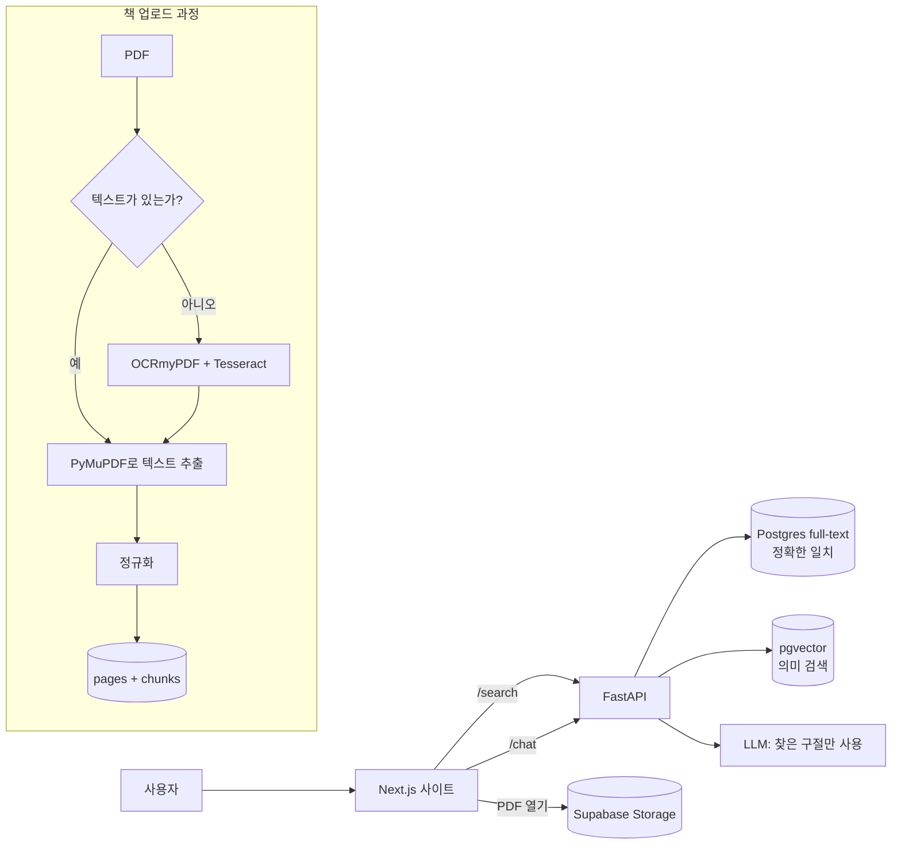

# Detector — 기술 계획 (v1)

> 목표: 사용자가 단어나 구절을 입력하면, 시스템은 업로드된 책에서만 검색하여 **어느 책, 어느 페이지, 어느 구절**에 있는지 정확히 보여준다.

---

## 1. 주요 결정 사항

| 항목 | 결정 | 이유 |
|---|---|---|
| AI "학습" | 모델을 **학습시키지 않음** | 학습된 모델은 내용을 지어낼 수 있어 100% 정확성에 어긋남 |
| 검색의 기반 | **Exact match** (전문 검색) | 결과는 책의 실제 텍스트에서만 가져옴 |
| AI 역할 | 보조: 유사 의미 검색 + 챗봇 | 결과는 "추정"으로 별도 표시 |
| 책 | 19권, 이후 관리자를 통해 추가 가능 | 현재 `KITOBLAR` 폴더 |
| 스캔된 책 | 먼저 텍스트 버전을 찾고, 없으면 OCR | 각 페이지에 출처 표시: `text` 또는 `ocr` |
| 챗봇 | 있음, 책 텍스트에만 근거 (RAG) | 모든 답변에 책 + 페이지 링크 포함 |

---

## 2. 기술 스택

### Frontend
- **Next.js 15** (App Router) + **TypeScript**
- **MUI** — 기성 컴포넌트 (Card, Drawer, TextField)
- **Tailwind CSS** — 빠른 스타일링과 글래스모피즘
- **Framer Motion** — 모든 애니메이션 (`layoutId`, `spring`, `AnimatePresence`)
- **react-pdf** (PDF.js) — 책 페이지 표시 및 단어 하이라이트
- **TanStack Query** — API 요청 및 캐싱

### Backend
- **Python 3.12 + FastAPI**
- **PyMuPDF (fitz)** — PDF에서 페이지별 텍스트와 단어 좌표 추출
- **OCRmyPDF + Tesseract** (`uzb` + `uzb_cyrl` 언어) — 스캔된 책용
- **LlamaIndex** — 챗봇용 RAG (책에서 찾은 후 답변)
- **임베딩 모델:** `intfloat/multilingual-e5-large` (우즈베크어도 이해함)
- **LLM (챗봇):** OpenAI 또는 다른 API, 주어진 구절만을 근거로 답하도록 강제

### 데이터베이스
- **Supabase (PostgreSQL)**
  - `pg_trgm` + full-text search — 정확하고 오타에 강한 단어 검색
  - `pgvector` — 의미 기반 검색
  - **Supabase Storage** — PDF 파일
- Pinecone은 필요 없음: 모두 하나의 Supabase 안에서, 저렴하고 간단함

---

## 3. 아키텍처



### 검색 순서 (우선순위)
1. **정확한 일치** — 구절이 그대로 일치 (가장 높은 신뢰도)
2. **단어 형태** — 접미사 포함 (`kitob`, `kitobni`, `kitoblar`)
3. **의미 기반** — 임베딩을 통해, "추정" 표시와 함께

### 정규화 (정확성에 매우 중요)
- `o‘ o' oʻ o`` → 하나의 형태로; `g‘`도 마찬가지
- `ʼ ’ '` 아포스트로피 기호 통합
- 키릴 ↔ 라틴: 검색이 두 문자 체계 모두에서 작동
- 원본 텍스트는 변경되지 않으며, 정규화된 사본은 검색용으로만 저장

---

## 4. 데이터베이스 구조

```text
books   : id, title, author, file_url, page_count, source_type (text|ocr|mixed)
pages   : id, book_id, page_number, text_raw, text_norm, source (text|ocr), ocr_confidence
chunks  : id, book_id, page_number, text, embedding (vector 1024)
words   : page_id, word, x0, y0, x1, y1      -- PDF에서 단어를 정확히 하이라이트하기 위해
```

---

## 5. API

| Endpoint | 기능 |
|---|---|
| `GET /search?q=...` | 책 목록 + 검색 결과 수 + 짧은 구절 |
| `GET /books/{id}/matches?q=...` | 책 안의 모든 일치 항목: 페이지, 구절, 좌표 |
| `POST /chat` | 질문에 대한 책 텍스트 기반 답변 + 출처 |
| `POST /admin/books` | 새 책 업로드 (추후) |

---

## 6. 사이트 (2페이지)

### 1페이지: 검색 및 결과
- 배경에 레기스탄 사진 (`fixed`), 위에 어두운 반투명 레이어 + 블러, 마우스에 따른 가벼운 패럴랙스
- **인트로:** 중앙의 큰 레이더가 "스캔"한 후, `layoutId`로 작아지며 로고 위치로 날아가 자리 잡음
- 글래스모피즘 검색 패널
- 검색 시 레이더 스캔 애니메이션
- 결과: 책 카드가 하나씩 떠오름 (`staggerChildren`), 각 카드에 개수 + 2–3개의 짧은 구절, 단어는 금색

### 2페이지: 책 보기
- 카드를 클릭하면 부드럽게 확장되며 이 페이지로 이동
- 왼쪽에 일치 항목 목록 (페이지 + 구절), 가운데에 PDF 페이지
- 찾은 단어는 노란 빛으로 하이라이트
- `이전 / 다음` 버튼과 `3 / 12` 카운터

### 챗봇
- 오른쪽 하단 모서리에 레이더 스타일 버튼
- 클릭하면 오른쪽에서 패널이 나옴
- 답변의 각 출처를 클릭하면 해당 책의 그 페이지로 이동
- 책에서 답을 찾지 못하면: "책에서 이에 대한 정보를 찾을 수 없습니다"라고 말하며, 스스로 지어내지 않음

### 디자인
- 색상: 터키석 / 파랑 (레기스탄 타일) + 금색
- 글꼴: Inter
- 다크 테마

---

## 7. 프로젝트 구조

```text
Detector/
├── frontend/          # Next.js 15
│   ├── app/
│   │   ├── page.tsx               # 검색
│   │   └── book/[id]/page.tsx     # 책 보기
│   ├── components/  (Radar, SearchBar, ResultCard, PdfViewer, ChatWidget)
│   └── public/registon.jpg
├── backend/           # FastAPI
│   ├── app/main.py
│   ├── app/search.py
│   ├── app/chat.py
│   └── ingest/        # PDF → 텍스트 → DB
│       ├── extract.py
│       ├── ocr.py
│       └── normalize.py
└── KITOBLAR/          # PDF 19권
```

---

## 8. 작업 단계

1. **책 준비** — 스캔된 책 7권의 텍스트 버전 찾기, 나머지는 OCR
2. **Ingest** — 모든 책을 페이지별로 DB에 저장
3. **정확성 검증** — 50–100개의 테스트 구절로 결과를 수동 비교
4. **Backend API** — 검색과 채팅
5. **Frontend** — 2페이지, 디자인과 모션
6. **챗봇**
7. **배포** — 프론트엔드는 Vercel, 백엔드는 Railway 또는 Render, DB는 Supabase

---

## 9. 위험 요소

- **OCR 오류** — 특히 `o‘`, `g‘` 및 오래된 글꼴에서; `ocr_confidence`가 낮은 페이지는 수동 확인
- **저작권** — 사이트를 공개하기 전에 책과 레기스탄 사진의 라이선스를 확인해야 함
- **LLM 비용** — 챗봇 요청은 유료 API일 수 있음
